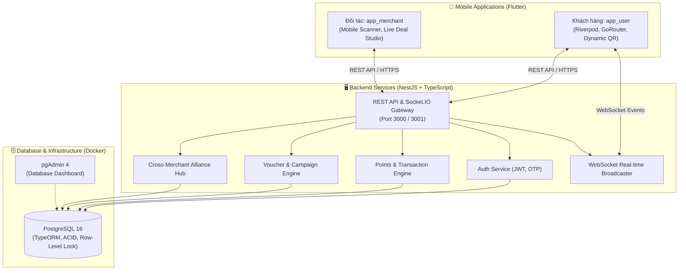

# 🔔 TingTing - Nền Tảng Tích Hợp Ví Điểm Thưởng Tập Trung
### *Hệ Sinh Thái CRM Liên Minh & Đổi Thưởng Đa Doanh Nghiệp (Loyalty & Rewards Alliance Platform)*

[](https://flutter.dev)
[](https://nestjs.com)
[](https://www.typescriptlang.org)
[](https://www.postgresql.org)
[](https://typeorm.io)
[](https://socket.io)
[](https://www.docker.com)
[](LICENSE)

> 🏆 **Dự án tham gia cuộc thi:** *“Sinh viên với ý tưởng sáng tạo & Khởi nghiệp” năm 2026*  
> 🏫 **Đơn vị tổ chức:** Trường Đại học Mở TP. Hồ Chí Minh (OU)

---

## 📖 1. Giới thiệu Dự án

Trong thời đại bán lẻ và dịch vụ số hóa mạnh mẽ, khách hàng đang phải đối mặt với **"nạn phân mảnh ứng dụng"** (App Fatigue): mỗi quán cà phê, tiệm trà sữa, spa hay nhà hàng đều yêu cầu tải một app tích điểm riêng hoặc giữ thẻ cứng. Đối với các doanh nghiệp vừa và nhỏ (SMEs), chi phí phát triển, duy trì và vận hành một ứng dụng thành viên riêng là quá đắt đỏ và hiệu quả tiếp cận khách hàng mới bị giới hạn.

**TingTing** ra đời như một giải pháp công nghệ mang tính đột phá nhằm xây dựng **Hệ sinh thái CRM Liên minh & Ví điểm thưởng tập trung**:
- Tích hợp thẻ thành viên, ví điểm thưởng và e-voucher của hàng loạt thương hiệu vào **một ứng dụng di động duy nhất**.
- Cho phép các đối tác SME tham gia mạng lưới **Tiếp thị chéo (Cross-Merchant Promotion)**: Doanh nghiệp F&B có thể liên kết tung voucher tại rạp chiếu phim, spa liên kết với cửa hàng thời trang để chia sẻ tệp khách hàng với chi phí tiếp thị gần như 0 đồng.
- Vận hành cực kỳ tinh gọn: Doanh nghiệp chỉ cần sử dụng ứng dụng di động hoặc mã QR tĩnh tại quầy, không cần nâng cấp hệ thống POS tốn kém.

---

## 👥 2. Đội ngũ Thực hiện

| STT | Họ và Tên | Chuyên ngành | Vai trò |
|:---:|:---|:---|:---|
| 1 | **Nguyễn Thị Thùy Trang** | Công nghệ Thông tin | Trưởng nhóm (Leader / PM) |
| 2 | **Nguyễn Ngọc Thanh Trúc** | Công nghệ Thông tin | Thành viên (Frontend / UI-UX) |
| 3 | **Nguyễn Nhật Thiên** | Công nghệ Thông tin | Thành viên (Full-stack / System Architecture) |
| 4 | **Võ Minh Thông** | Công nghệ Thông tin | Thành viên (Backend & Database) |
| 5 | **Nguyễn Thanh Trúc** | Tài chính - Ngân hàng (TCNN) | Thành viên (Business / Finance / Marketing) |

---

## 🎯 3. Giá trị Cốt lõi & Đối tượng Hưởng lợi

### 🏢 Đối với Doanh nghiệp Đối tác (SME - B2B)
- **Tối ưu hóa nguồn lực:** Số hóa toàn diện quy trình chăm sóc khách hàng với mô hình SaaS, tiết kiệm hàng chục triệu đồng chi phí đầu tư phần mềm riêng.
- **Tiếp thị chéo (Cross-Marketing Alliance):** Tận dụng tệp khách hàng trung thành của các thương hiệu khác trong liên minh để thu hút khách hàng mới chất lượng cao.
- **Vận hành phi can thiệp:** Chỉ cần quét mã bằng Camera điện thoại hoặc đặt QR tĩnh tại quầy, sẵn sàng hoạt động trong 5 phút.
- **Báo cáo thời gian thực:** Thống kê chi tiết lượng điểm phát hành, số voucher đã tiêu thụ, tỷ lệ quay lại của khách hàng.

### 📱 Đối với Người dùng cuối (End-User - B2C)
- **"All-in-One" tiện lợi:** Chấm dứt tình trạng đầy bộ nhớ vì tải hàng chục ứng dụng tích điểm. Toàn bộ điểm và ưu đãi quản lý tại một nơi.
- **Định danh duy nhất (Unified ID):** Đưa mã QR cá nhân cho thu ngân quét 1 lần duy nhất để vừa nhận diện thành viên, vừa tích điểm, vừa hưởng ưu đãi.
- **Đổi thưởng phong phú:** Điểm tích lũy từ quán cà phê yêu thích có thể dùng để đổi vé xem phim, voucher pizza, trà sữa hoặc quà tặng giải trí.
- **Bảo vệ quyền lợi:** Không lo mất thẻ vật lý, voucher tự động nhắc hạn sử dụng.

### 🌿 Đối với Cộng đồng & Xã hội (ESG)
- **Bảo vệ môi trường (Green & Sustainable):** Cắt giảm hàng triệu thẻ nhựa PVC và hóa đơn/voucher in mực hóa học khó phân hủy.
- **Thúc đẩy chuyển đổi số bình đẳng:** Giúp các hộ kinh doanh nhỏ lẻ, quán ăn truyền thống tiếp cận năng lực công nghệ tương đương các chuỗi lớn.

---

## 🏗️ 4. Kiến trúc Hệ thống & Tech Stack

Dự án được tổ chức theo cấu trúc **Monorepo** chuẩn mực, phân tách rõ ràng giữa Mobile Frontend, Backend API Gateway và Hệ quản trị cơ sở dữ liệu.



### 💻 Chi tiết Công nghệ Sử dụng

| Thành phần | Công nghệ chính | Vai trò / Tính năng nổi bật |
|---|---|---|
| **User Mobile App** | **Flutter 3.x**, Riverpod, GoRouter, Dio | Giao diện hiện đại (Vàng `#FAD240`, Hồng `#E8687D`), Dynamic QR đổi mã tự động, hiển thị voucher vé xé (Ticket notch clipper), thông báo real-time. |
| **Merchant App** | **Flutter 3.x**, Mobile Scanner, Riverpod | Quét mã khách/voucher bằng Camera siêu tốc, tạo chiến dịch ưu đãi (nội bộ & liên minh), báo cáo chỉ số kinh doanh trực quan. |
| **Backend Engine** | **NestJS 10.x (TypeScript)** | Kiến trúc Module hóa cao, xử lý nghiệp vụ tích điểm, đổi thưởng, bảo mật phân quyền RBAC. |
| **ORM & Database** | **TypeORM** + **PostgreSQL 16** | Đảm bảo tính toàn vẹn **ACID**, bảo vệ giao dịch đổi voucher bằng **Pessimistic Row-Level Lock** chống Double-Spending. |
| **Real-time System** | **Socket.IO (WebSocket)** | Bắn thông báo tức thì (Push Notification) về app người dùng ngay khi thu ngân quét mã cộng điểm tại quầy. |
| **DevOps & Container** | **Docker & Docker Compose** | Tự động hóa khởi tạo cơ sở dữ liệu PostgreSQL và pgAdmin chỉ với một câu lệnh. |

---

## ✨ 5. Các Tính Năng Nổi Bật

### 1. 📱 Ứng Dụng Khách Hàng (`app_user`)
- **Đăng nhập siêu tốc:** Xác thực số điện thoại bằng OTP tiện lợi.
- **Mã QR Tích Điểm Động (Dynamic QR):** Tự động sinh mã định danh và làm mới mỗi 60 giây, ngăn chặn triệt để hành vi chụp màn hình hoặc gian lận điểm.
- **Sàn Đổi Thưởng Đa Thương Hiệu (Rewards Marketplace):** Tìm kiếm, lọc deal theo danh mục (Ăn uống, Mua sắm, Giải trí), xem chi tiết điều kiện và đổi voucher ngay bằng điểm tích lũy.
- **Ví Ưu Đãi Của Tôi (My Vouchers):** Quản lý voucher theo trạng thái (Khả dụng, Đã dùng, Hết hạn), hiển thị đồng thời **Mã vạch Vector** và **Mã QR trực quan** để thu ngân quét dễ dàng.
- **Thông Báo Tức Thời (Real-time Alert):** Nhận popup chúc mừng và cập nhật số dư điểm ngay khi thu ngân vừa xác nhận hóa đơn.

### 2. 🏪 Ứng Dụng Cửa Hàng Đối Tác (`app_merchant`)
- **Quét Camera Đa Năng (Dual Scan Mode):**
  - *Chế độ Tích điểm:* Quét mã QR khách hàng ➔ Nhập số tiền hóa đơn ➔ Hệ thống tự tính số điểm thưởng theo tỷ lệ cấu hình.
  - *Chế độ Dùng Voucher:* Quét mã barcode/QR voucher của khách ➔ Kiểm tra tính hợp lệ và tự động trừ ưu đãi.
- **Studio Tạo Deal & Chiến Dịch (Deal Creator):**
  - Tạo e-voucher tùy biến: tiêu đề, mô tả, mức điểm đổi, số lượng phát hành, thời hạn sử dụng.
  - Live Card Preview: Xem trước giao diện voucher hiển thị trên app khách hàng theo thời gian thực.
- **Báo Cáo Đối Soát & CRM:** 4 thẻ chỉ số KPI tổng quan (Số voucher đang phát hành, Tổng điểm đã tặng, Tổng giao dịch, Lượng voucher đã sử dụng) cùng biểu đồ lịch sử giao dịch.
- **Mã QR Quầy Tĩnh:** Trưng bày mã QR của cửa hàng tại quầy thanh toán.

### 3. 🤝 Cơ Chế Kích Cầu Chéo (Cross-Merchant Promotion)
- **Liên minh mở rộng:** Cho phép một đối tác (ví dụ Highlands Coffee) tạo voucher được quyền áp dụng tại đối tác khác (ví dụ CGV Cinema).
- **Huy hiệu Liên minh:** Hiển thị tag `🤝 LIÊN MINH`, vinh danh thương hiệu tài trợ và ghi rõ địa điểm áp dụng trên cả 2 ứng dụng.
- **Phân quyền kiểm duyệt:** Hệ thống backend tự động xác thực và cho phép đối tác thụ hưởng quét trừ voucher do đối tác tài trợ phát hành.

---

## 📁 6. Cấu Trúc Thư Mục Dự Án

```text
TingTing/
├── app_user/                  # Flutter App dành cho Người dùng cuối (B2C)
│   ├── lib/
│   │   ├── core/              # Theme, Router, ApiClient, SocketClient
│   │   ├── models/            # Data models (User, Voucher, Transaction, Merchant)
│   │   ├── providers/         # Quản lý State bằng Riverpod
│   │   ├── screens/           # Home, Earn (QR), Rewards, My Vouchers, Account
│   │   └── widgets/           # TicketNotch, Barcode, VoucherCard
│   └── pubspec.yaml
│
├── app_merchant/              # Flutter App dành cho Cửa hàng / Thu ngân (B2B)
│   ├── lib/
│   │   ├── core/              # Theme, Router, ApiClient, AuthState
│   │   ├── models/            # Data models đối tác, chiến dịch, thống kê
│   │   ├── providers/         # ScannerProvider, DealProvider, ReportProvider
│   │   ├── screens/           # Scan Camera, Create Deal, Report, Account
│   │   └── widgets/           # MetricCard, TransactionTile, QuickPartnerSelector
│   └── pubspec.yaml
│
├── backend/                   # Backend API Engine (NestJS + TypeORM)
│   ├── src/
│   │   ├── config/            # Cấu hình môi trường & tỷ lệ tích điểm
│   │   ├── entities/          # User, Merchant, Voucher, UserVoucher, Transaction
│   │   ├── modules/           # Auth, Users, Merchants, Points, Vouchers, Socket
│   │   ├── seed/              # Script sinh dữ liệu mẫu thực tế cho Demo
│   │   └── main.dart / app.module.ts
│   └── package.json
│
├── docker/                    # Cấu hình khởi tạo PostgreSQL Container
│   └── init.sql
├── docker-compose.yml         # Khởi động PostgreSQL 16 & pgAdmin 4
├── docs/                      # Tài liệu kỹ thuật chi tiết
│   ├── Architecture.md        # Thiết kế kiến trúc tổng thể
│   ├── DEVELOPER_GUIDE.md     # Hướng dẫn chi tiết cho lập trình viên
│   ├── CODE_STANDARDS.md      # Quy chuẩn viết code & comment
│   ├── UI_Design_Rules.md     # Bảng màu, tỷ lệ & quy chuẩn UI Flutter
│   └── task_tracker.md        # Danh mục tiến độ hoàn thành các Task
├── README.md                  # Giới thiệu tổng quan dự án (File này)
└── SETUP.md                   # Hướng dẫn cài đặt môi trường từ A - Z
```

---

## ⚡ 7. Hướng Dẫn Cài Đặt & Chạy Nhanh (Quick Start)

> 💡 Để xem hướng dẫn từng bước chi tiết hơn và cách xử lý lỗi thường gặp, vui lòng tham khảo [SETUP.md](SETUP.md).

### Yêu cầu tiên quyết:
- **Node.js** >= 20.x & **npm** >= 10.x
- **Flutter SDK** >= 3.x
- **Docker & Docker Compose**
- **Git**

### Bước 1: Khởi động Cơ sở dữ liệu (PostgreSQL)
Tại thư mục gốc dự án:
```bash
docker-compose up -d
```
*Docker sẽ tự động tạo cơ sở dữ liệu `tingting_db` trên cổng `5432` và pgAdmin trên cổng `5050`.*

### Bước 2: Khởi động Backend Server
```bash
cd backend
npm install
cp .env.example .env     # Kiểm tra các thông số kết nối DB
npm run start:dev
```
*API sẽ lắng nghe tại `http://localhost:3000`, WebSocket gateway tại cổng `3001`.*

### Bước 3: Nạp dữ liệu mẫu Demo (Seed Data)
Mở một cửa sổ Terminal mới tại thư mục `backend`:
```bash
npm run seed
```
*Script sẽ tự động tạo 5 thương hiệu đối tác tiêu biểu (Highlands, The Coffee House, Phuc Long, CGV, Pizza 4P's), người dùng mẫu và hàng chục voucher đơn lẻ lẫn deal liên minh.*

### Bước 4: Khởi chạy Ứng dụng Di động (Flutter)

**Chạy App Khách hàng (`app_user`):**
```bash
cd app_user
flutter pub get
flutter run
```

**Chạy App Cửa hàng (`app_merchant`):**
```bash
cd app_merchant
flutter pub get
flutter run
```

> **Mẹo kết nối thiết bị thật qua USB:**
> Chạy lệnh `adb reverse tcp:3000 tcp:3000 && adb reverse tcp:3001 tcp:3001` để thiết bị Android thật có thể kết nối trực tiếp đến backend chạy trên máy tính qua `127.0.0.1`.

---

## 🛣️ 8. Lộ Trình Phát Triển (Roadmap)

- [x] **Giai đoạn 1 (MVP Cốt lõi):**
  - Hoàn thiện trọn vẹn Backend REST API, WebSocket real-time và hệ thống cơ sở dữ liệu PostgreSQL.
  - Hoàn thiện `app_user` với đầy đủ luồng: OTP, Dynamic QR, Đổi điểm nhận voucher, Thông báo real-time.
  - Hoàn thiện `app_merchant` với: Quét camera siêu tốc, Tạo deal tùy biến, Báo cáo đối soát CRM.
  - Hiện thực hóa cơ chế **Tung Deal Liên Minh Kích Cầu Chéo (Cross-Merchant Promotion)**.
- [ ] **Giai đoạn 2 (Thử nghiệm thị trường):**
  - Triển khai thí điểm tại 20 - 50 doanh nghiệp SME F&B và bán lẻ theo chiến lược cụm (Cluster Strategy).
  - Tối ưu hóa thuật toán đề xuất ưu đãi theo vị trí địa lý người dùng (Geofencing & Google Maps).
- [ ] **Giai đoạn 3 (Thương mại hóa & Mở rộng):**
  - Phát triển Web Admin Portal chuyên sâu cho Chủ chuỗi thương hiệu để phân tích Big Data.
  - Mở rộng mạng lưới đối tác lên 200+ thương hiệu tại TP. Hồ Chí Minh.
- [ ] **Giai đoạn 4 (Hệ sinh thái Toàn diện):**
  - Tích hợp cổng thanh toán trực tuyến (MoMo, ZaloPay, VietQR).
  - Ứng dụng Trí tuệ Nhân tạo (AI & Machine Learning) để dự báo xu hướng tiêu dùng và tự động đề xuất chiến dịch Cross-Marketing tối ưu doanh thu cho đối tác.

---

## 💰 9. Mô Hình Kinh Doanh

1. **Phí Dịch Vụ SaaS (Subscription Fee):** Gói thuê bao hàng tháng linh hoạt cho doanh nghiệp sử dụng nền tảng CRM và công cụ quản trị khách hàng.
2. **Phí Giao Dịch Đổi Thưởng (Success Fee):** Phần trăm hoa hồng nhỏ trên mỗi e-voucher được quy đổi và áp dụng thành công tại cửa hàng.
3. **Quảng Cáo & Truyền Thông (Marketing Promotion):** Phí ưu tiên hiển thị banner hot, đề xuất deal trang chủ và gửi thông báo trực tiếp đến khách hàng tiềm năng.
4. **Phân Tích Dữ Liệu Chuyên Sâu (Premium Analytics):** Cung cấp các báo cáo hành vi người tiêu dùng theo ngành hàng cho các đối tác lớn.

---

## 📄 10. Bản Quyền & Giấy Phép

Dự án được bảo hộ quyền tác giả cho mục đích tham gia cuộc thi Khởi nghiệp năm 2026. Mã nguồn được phát triển bởi **Nhóm Dự Án TingTing** - Trường Đại học Mở TP. Hồ Chí Minh.

Mọi ý kiến đóng góp và thắc mắc xin vui lòng mở Issue hoặc liên hệ ban quản trị dự án qua repository này.

---
<p align="center">
  <b>TingTing - Một chạm tích điểm, ngập tràn niềm vui! 🔔✨</b>
</p>
